# 도로 면접 (doro-interview)

[](https://github.com/yu-teacher/doro-interview/actions/workflows/ci.yml)

개발 면접 질문을 **읽고, 학습했다고 체크하고, 체크한 질문만 랜덤으로 풀어 보며** 준비하는 서비스입니다. 자바·스프링·데이터베이스·CS 기초·개발 도구·설계까지 **6개 카테고리, 35개 주제, 746개 질문**이 들어 있고, 전부 공식 문서와 대조해 검수했습니다. [Doro](https://github.com/yu-teacher/doro) 플랫폼의 서비스 중 하나(`/interview/`)이며, 폰에서 설치해 쓰는 PWA입니다.

<p align="center">
  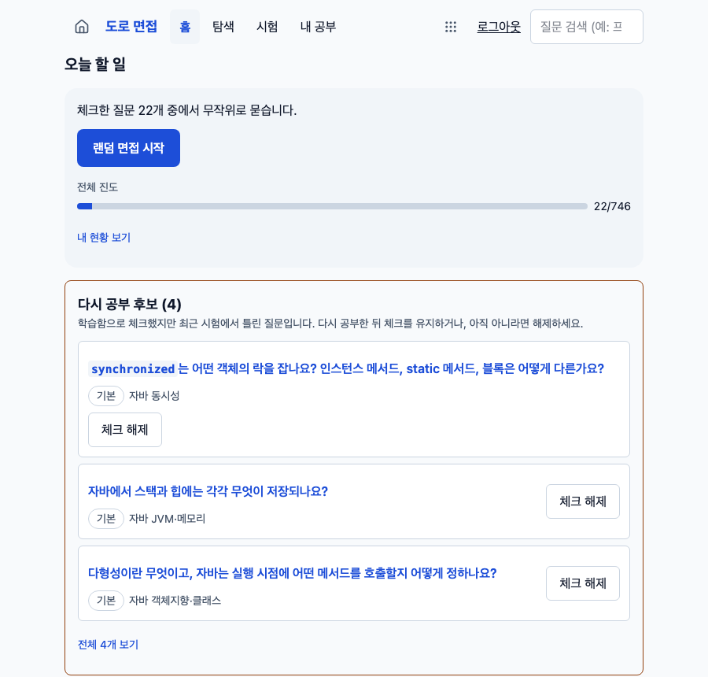
  &nbsp;
  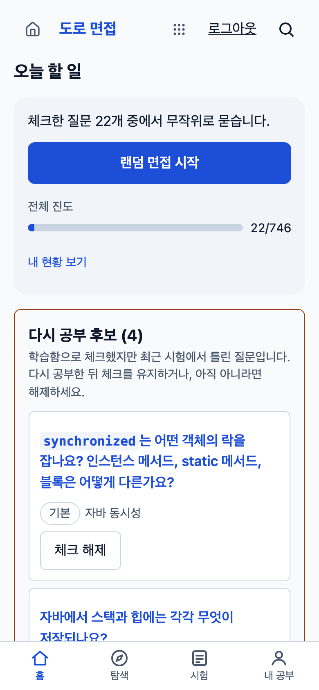
</p>

## 무엇을 하나요

- **질문 은행**: 카테고리 → 주제 → 질문. 난이도(기본·심화·함정)와 "꼭 나와요" 같은 필수도로 거르고, 개념(프록시, 트랜잭션 경계 등)으로도 찾습니다.
- **말로 하는 모범 답변**: 질문마다 30~60초로 말할 분량의 모범 답변, 핵심 키워드, 관련 개념, 그리고 근거·코드·실험 설명을 펼쳐 볼 수 있습니다. 출처는 `(공식 문서)`·`(보충)`·`(실험 확인)`으로 구분해 표시합니다.
- **학습 체크와 진도**: "완전히 학습함"으로 체크하면 주제별·전체 진도가 쌓입니다.
- **랜덤 면접**: 체크한 질문 중에서 가중 랜덤으로 출제합니다(안 나온 질문, 오래된 질문, 자주 틀린 질문이 더 잘 나옵니다). 내 답을 적고 모범 답변과 비교한 뒤 맞음·틀림·건너뜀을 스스로 채점합니다.
- **AI 피드백(선택)**: 버튼을 누르면 내 답을 모범 답변과 비교한 짧은 의견을 받습니다. 서버에서 켜고 끄며, 사용자·전체 하루 한도가 있습니다.
- **내 현황과 다시 공부 후보**: 정답률과 많이 틀린 질문을 보여 주고, 체크했지만 최근 시험에서 틀린 질문은 "다시 공부 후보"로 올립니다.
- **내 질문**: 강사님이 짚어 준 질문이나 모의 면접에서 나온 질문을 직접 추가하면 시험에 함께 나옵니다.
- **폰 우선 화면**: 아래 탭 바, 밝은·어두운 화면, 설치 가능한 PWA.

## 화면 둘러보기

> 단계별 설명은 [사용 가이드](docs/USAGE.md)에 있습니다.

| 탐색 | 주제 | 질문 |
| --- | --- | --- |
| 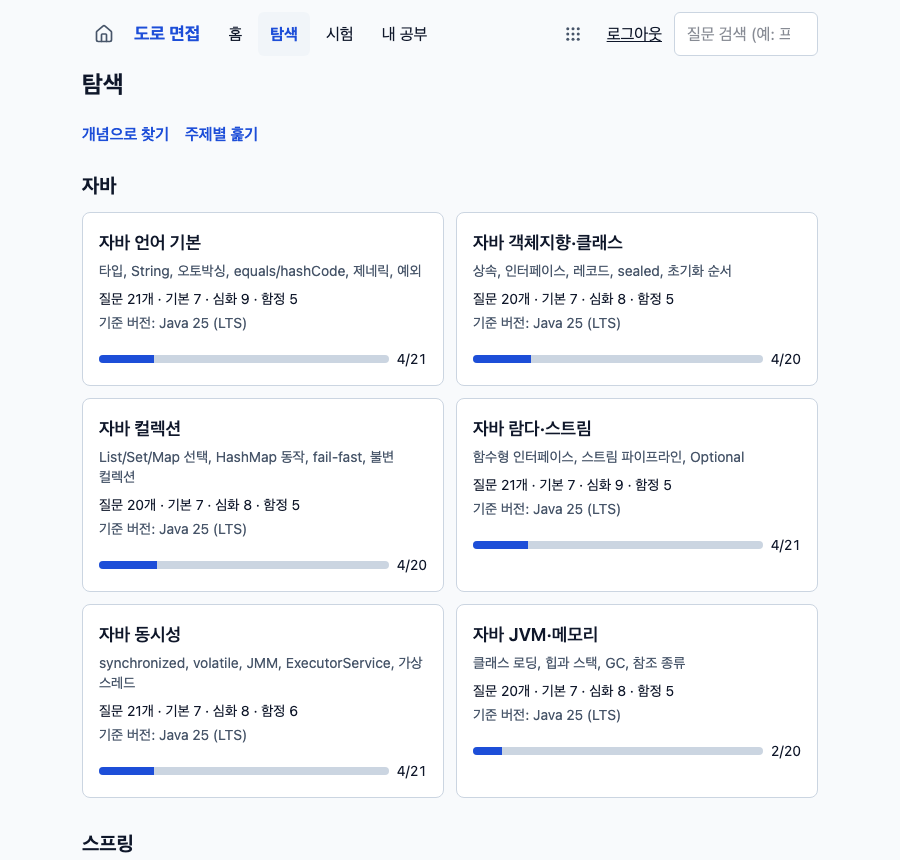 | 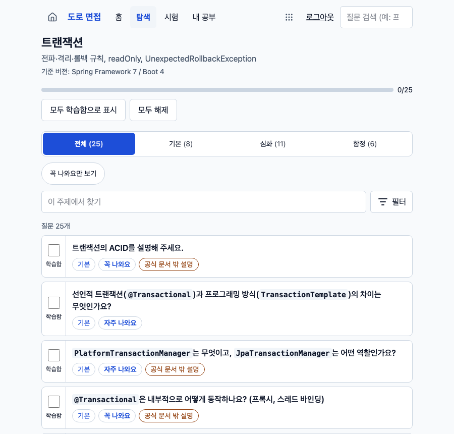 | 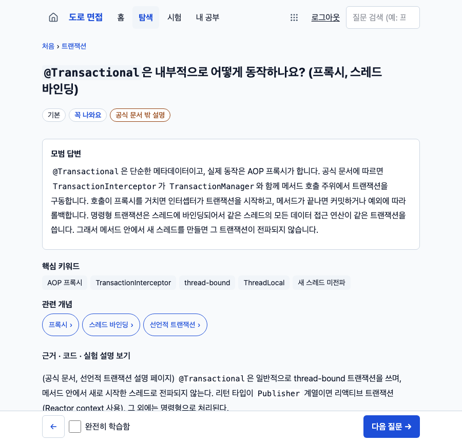 |

| 시험 시작 | 시험 진행 | 내 현황 |
| --- | --- | --- |
| 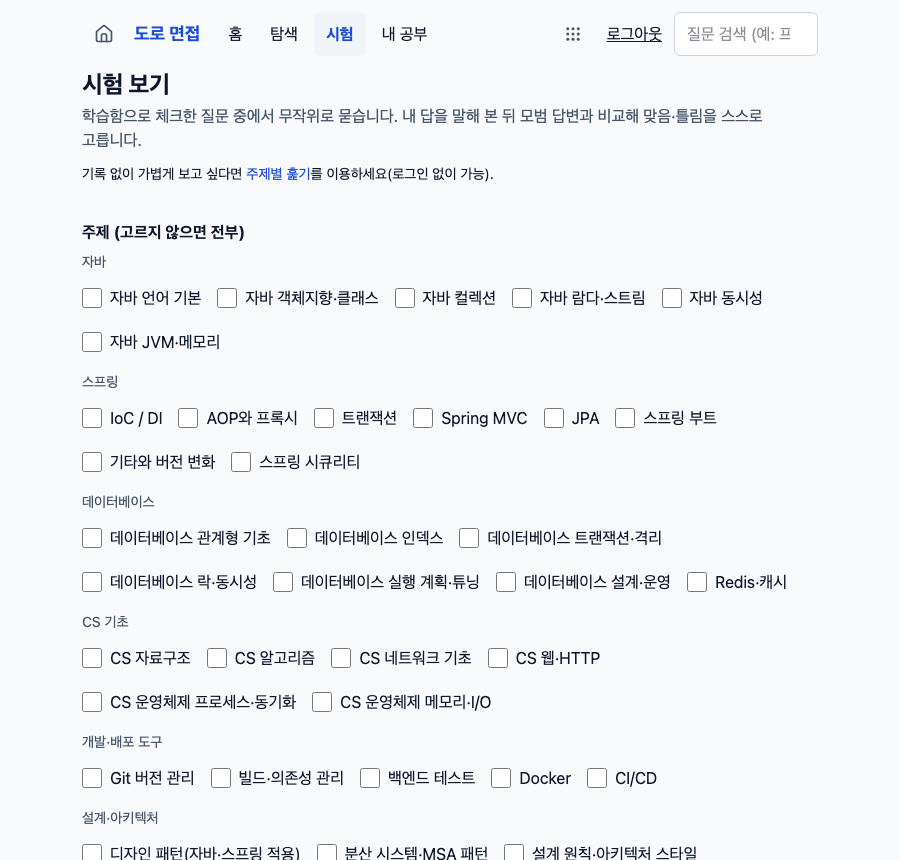 | 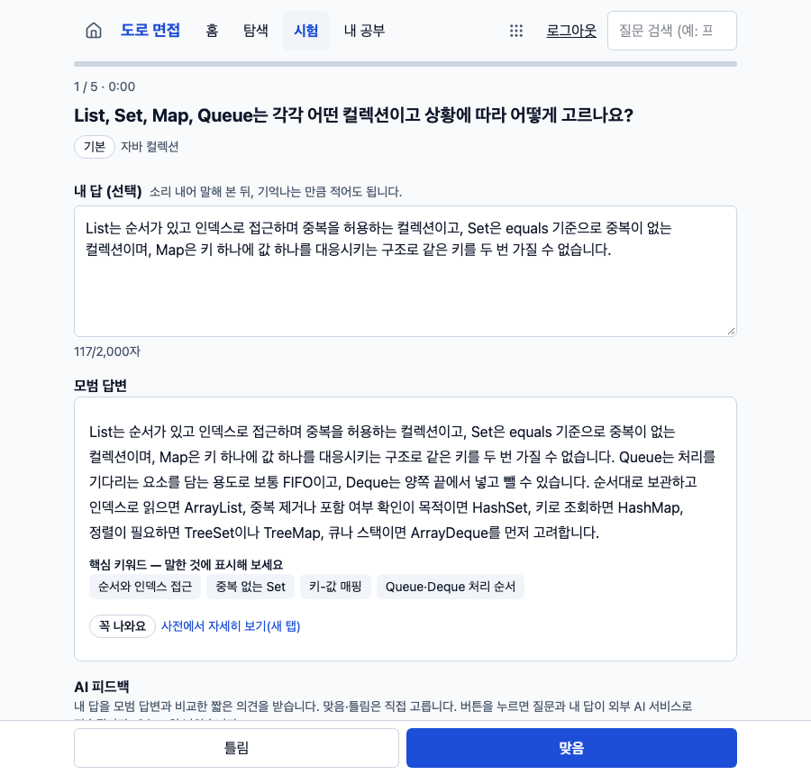 | 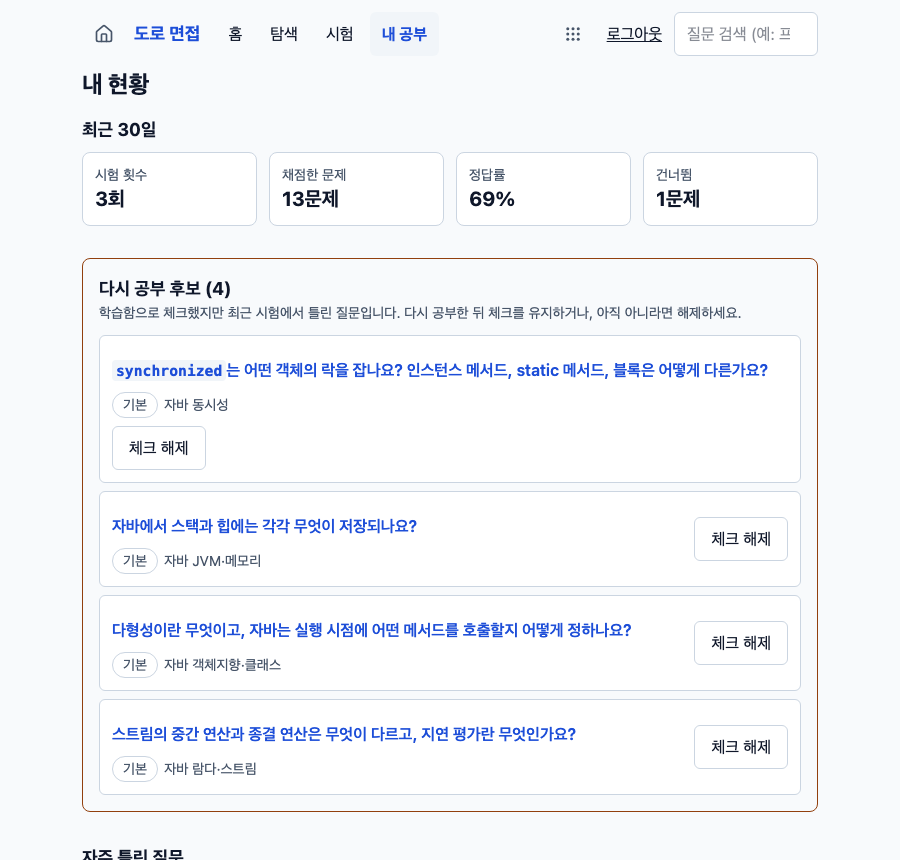 |

| 내 질문 | 모바일 질문 | 모바일(어둡게) |
| --- | --- | --- |
| 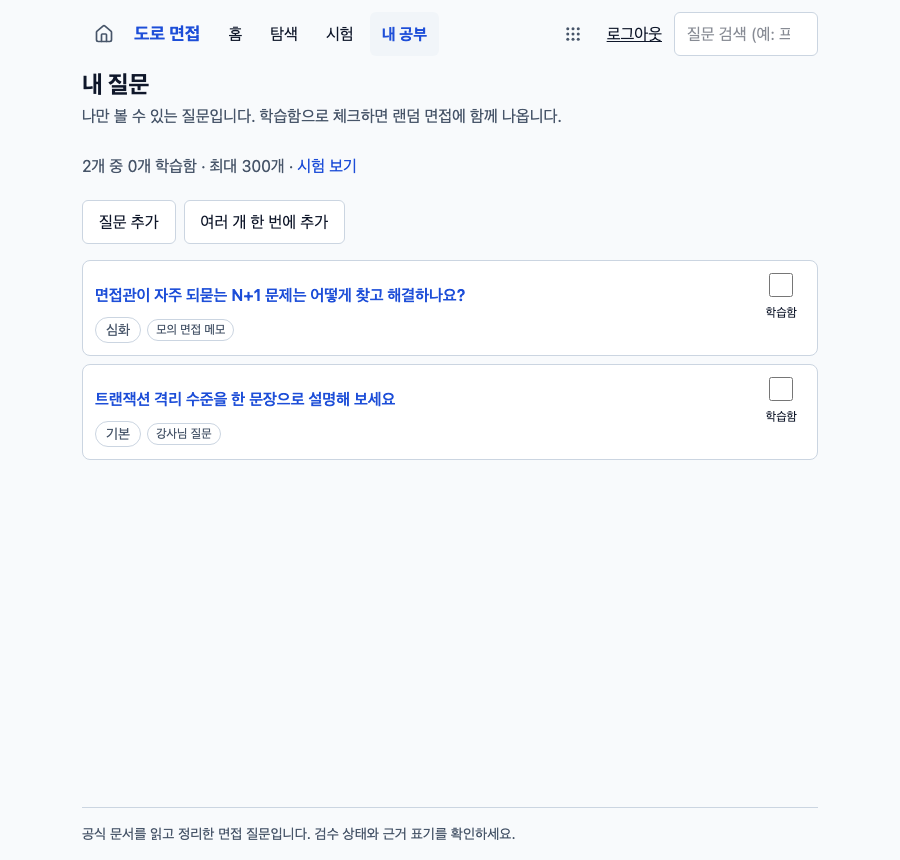 | 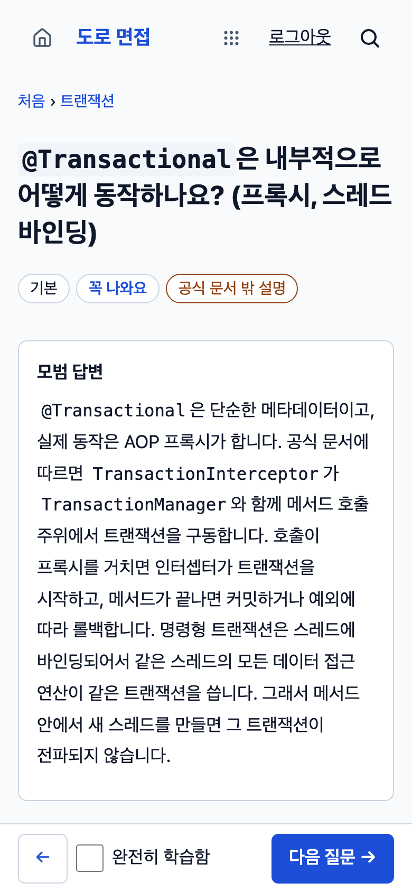 | 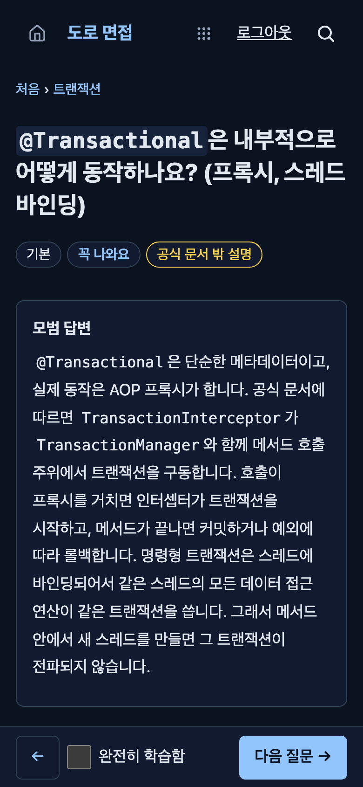 |

## 사용법

> 화면마다 번호를 붙여 설명한 **[사용 가이드](docs/USAGE.md)**가 따로 있습니다. 아래는 요약입니다.

1. **로그인**: 헤더의 로그인으로 Doro 계정에 로그인합니다. 처음이면 Doro의 `/signup`에서 가입합니다. 로그인하지 않아도 질문은 읽을 수 있고, 체크·시험·노트·내 질문은 로그인이 필요합니다.
2. **읽기**: **탐색**에서 주제를 고르고 질문을 엽니다. 질문 화면 아래의 **완전히 학습함**을 체크하면 진도에 반영됩니다. 이전·다음 질문으로 이어서 읽을 수 있습니다.
3. **시험**: **시험**에서 문제 수(1~30)를 정하고 시작합니다. 소리 내어 말해 본 뒤 기억나는 만큼 적고 **모범 답변 보기**를 눌러 비교하고, 핵심 키워드 중 말한 것을 떠올리며 **맞음 / 틀림**을 고릅니다. 체크하지 않은 질문도 포함할지 고를 수 있습니다. 새로고침하거나 다시 들어와도 이어서 풀 수 있습니다.
4. **복습**: **내 공부 → 내 현황**에서 정답률과 많이 틀린 질문을 보고, 홈의 **다시 공부 후보**에서 다시 읽거나 체크를 해제합니다.
5. **내 질문·노트**: 질문 화면에 노트를 적어 둘 수 있고, **내 공부 → 내 질문**에서 직접 만든 질문을 추가합니다(여러 개 한 번에 추가도 됩니다).
6. **설정**: **내 공부**에서 화면 색(시스템·밝게·어둡게)을 바꾸고, **학습 현황 초기화**로 학습 체크와 시험 기록을 지울 수 있습니다(노트와 내 질문은 남습니다).
7. **폰에 설치**: 브라우저 메뉴의 "홈 화면에 추가"로 설치합니다.

## 기술 스택

| 영역 | 사용 |
| --- | --- |
| 백엔드 | Java 25 · Spring Boot 4.1 · JdbcTemplate · Flyway · PostgreSQL 16 |
| AI 피드백 | Spring AI 2.0(Gemini 기본, Anthropic 선택) — 키가 없으면 그냥 꺼진 상태로 시작 |
| 인증 | Doro SDK(JWT 검증, 게이트웨이 BFF 세션, 탈퇴 동기화) |
| 프런트 | React 19 · Vite 6 · Tailwind 4 · React Router 7 · PWA(Workbox) |
| 콘텐츠 | `content/` 마크다운(YAML frontmatter) → 앱 시작 때 DB에 반영 |
| 검증 | JUnit·ArchUnit · Vitest · Playwright(모바일 감사, 통합 e2e) · 배포 리허설 |

## 구조

```
content/   질문 원본(마크다운). 빌드 때 jar 에 실리고, 시작할 때 DB 에 반영된다
src/       Spring Boot 백엔드
web/       React + Vite PWA
deploy/    게이트웨이(nginx) 설정 조각
scripts/   CI·e2e·배포 리허설·변환 도구
docs/      설계와 단계별 계획
```

백엔드는 모듈로 나뉘고, **의존 방향을 아키텍처 테스트가 강제**합니다.

```
account  → (없음)                        사용자 사본, 이벤트
catalog  → (없음)                        질문 사전(읽기)
mine     → account                       내 질문
progress → catalog, account, mine.read   학습 체크·노트
quiz     → catalog, account, progress.read, mine.read   시험·통계·AI 피드백
api      → 전부                          HTTP 합성
```

설계 판단(왜 이렇게 만들었는지)은 [docs/DESIGN.md](docs/DESIGN.md)에 있습니다. 핵심만 적으면:

- 질문 원본은 git의 마크다운이고 DB는 그 사본입니다. 검수는 diff로, 형식·링크·개수는 CI가 검사합니다.
- 브라우저는 토큰을 만지지 않습니다. 게이트웨이와 BFF가 HttpOnly 쿠키를 Bearer 토큰으로 바꿔 줍니다.
- 서비스의 쓰기 API는 `PUT`이고, 같은 요청을 다시 보내도 안전하게(같은 결과로) 설계했습니다.
- AI 호출은 프롬프트 주입을 전제로 설계했습니다(사용자 글은 태그로 감싼 데이터로만 전달, 구분 태그는 무력화, 응답은 마크다운으로만 그리고 원시 HTML은 해석하지 않음).

## 로컬에서 실행하기

필요: Docker, Java 25, Node 24, Python 3, 형제 디렉터리의 [Doro](https://github.com/yu-teacher/doro) 체크아웃(`../Doro`, 백엔드가 SDK를 소스로 빌드합니다), Playwright 내장 Chromium.

```bash
cd web && npm ci && npx playwright install chromium && cd ..

# 전체 스택을 띄워 둔다: 격리 Postgres + 백엔드 + 웹 + 게이트웨이 + 가짜 Doro(로그인 흉내)
E2E_HOLD=1 scripts/e2e-test.sh
```

처음엔 이미지·jar 빌드로 몇 분 걸립니다. 준비되면 **http://127.0.0.1:18490/interview/** 로 접속합니다. 가짜 Doro가 로그인을 대신하므로 헤더의 로그인을 누르면 바로 로그인됩니다(실제 Doro 연동은 아닙니다). 끝낼 때는 다른 터미널에서 다음을 실행하면 모두 정리됩니다.

```bash
rm /tmp/e2e-hold
```

## 테스트

```bash
scripts/ci-test.sh backend   # 격리 Postgres 를 올려 백엔드 테스트(ArchUnit 모듈 규칙·콘텐츠 정합성 포함) 후 내린다
scripts/ci-test.sh web       # 프런트 린트·타입·단위 테스트·빌드·번들 예산
scripts/ci-test.sh mobile    # 모바일 레이아웃·접근성: 폰 폭 4가지 × 밝게/어둡게, axe·색 대비·터치 영역(실제 Chromium 헤드리스)
scripts/ci-test.sh e2e       # 통합 e2e: 격리 DB + 백엔드 jar + 웹 + 게이트웨이(CSP 강제) + 실제 Chromium
scripts/ci-test.sh rehearse  # 배포 리허설: 실제 이미지·배포 스크립트·롤백(도커 레지스트리 필요)
```

시스템 Chrome이 아니라 Playwright 내장 Chromium(헤드리스)을 씁니다. 같은 검증이 GitHub Actions의 CI에서 돌고, 통과하면 배포됩니다.

## 라이선스

- 소스 코드: [MIT](LICENSE)
- 질문 콘텐츠(`content/`)와 문서(`docs/`): [CC BY 4.0](LICENSE-CONTENT.md) — 출처를 밝히면 자유롭게 쓸 수 있습니다.

## 문서

- 사용법: [사용 가이드(화면별 설명)](docs/USAGE.md)
- 설계: [DESIGN](docs/DESIGN.md) · 프런트 설계: [FRONTEND-DESIGN](docs/FRONTEND-DESIGN.md)
- 단계별 계획: [M0](docs/M0-PLAN.md) · [M1](docs/M1-PLAN.md) · [M2](docs/M2-PLAN.md) · [M3](docs/M3-PLAN.md) · [M4](docs/M4-PLAN.md) · [M6(AI 피드백)](docs/M6-PLAN.md) · [REFS](docs/REFS-PLAN.md)
- 콘텐츠: [작성·수정 방법](docs/CONTENT-GUIDE.md) · [검수 트랙](docs/REVIEW-TRACK.md)
- 배포: [DEPLOY](docs/DEPLOY.md) · 방문 통계: [ANALYTICS](docs/ANALYTICS.md)
