# 도로 면접 사용 가이드

화면에 붙은 **빨간 번호**는 아래 설명의 번호와 같습니다. 처음 오셨다면 1번부터 순서대로 따라 하면 됩니다. (이 화면은 샘플 데이터로 찍은 것이라 진도와 정답률은 예시입니다.)

- [시작하기](#1-로그인) · [질문 읽기](#2-질문-고르기) · [시험 보기](#6-시험-시작하기) · [복습하기](#10-다시-공부-후보-고르기) · [내 공간](#12-내-공부) · [폰에서 쓰기](#17-폰에서-쓰기)

## 1. 로그인

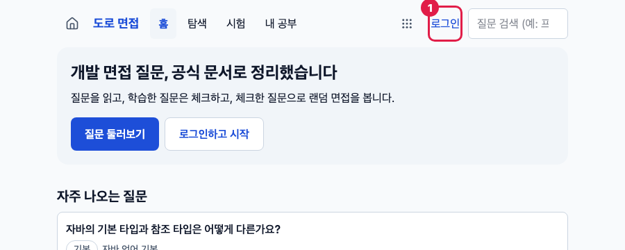

1. 헤더의 **로그인**을 누르면 Doro 계정으로 로그인합니다. 계정이 없으면 Doro의 가입 화면(`/signup`)에서 이름·이메일·비밀번호로 가입합니다.

로그인하지 않아도 **질문 읽기, 검색, 주제별 훑기**는 됩니다. **학습 체크, 시험, 노트, 내 질문, 내 현황**은 로그인이 필요합니다.

## 2. 질문 고르기

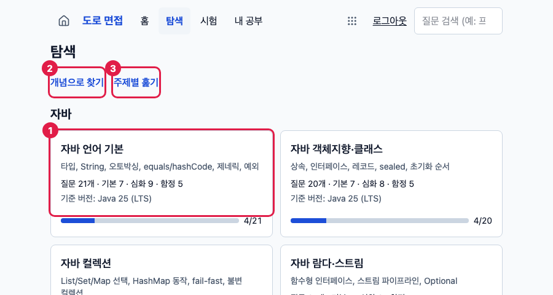

1. **주제 카드**를 누르면 그 주제의 질문 목록으로 갑니다. 카드의 파란 막대는 내 학습 진도입니다(로그인했을 때).
2. **개념으로 찾기**: 주제와 상관없이 "프록시", "트랜잭션 경계" 같은 개념으로 질문을 모아 봅니다.
3. **주제별 훑기**: 기록을 남기지 않고 가볍게 훑는 모드입니다([16번](#16-주제별-훑기)).

## 3. 주제 안에서 거르기

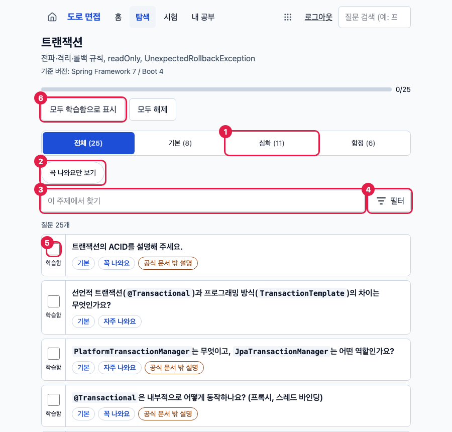

1. **난이도 탭**: 전체 · 기본 · 심화 · 함정. 괄호는 질문 수입니다.
2. **꼭 나와요만 보기**: 필수도가 가장 높은 질문만 보여 줍니다.
3. **이 주제에서 찾기**: 이 주제 안에서만 검색합니다.
4. **필터**: 필수도, 개념, 내 체크 상태(학습함/아직 안 함), "공식 문서 밖 설명만"을 고릅니다. 적용한 필터는 칩으로 보이고, 누르면 그 필터만 풀립니다.
5. **학습함 체크박스**: 질문을 읽고 충분히 학습했다면 여기서 바로 체크합니다(로그인 필요).
6. **모두 학습함으로 표시 / 모두 해제**: 이 주제의 질문 **전체**를 한 번에 바꿉니다(필터와 상관없이). 누르면 확인창에 바뀔 질문 수가 먼저 나옵니다.

## 4. 질문 읽기

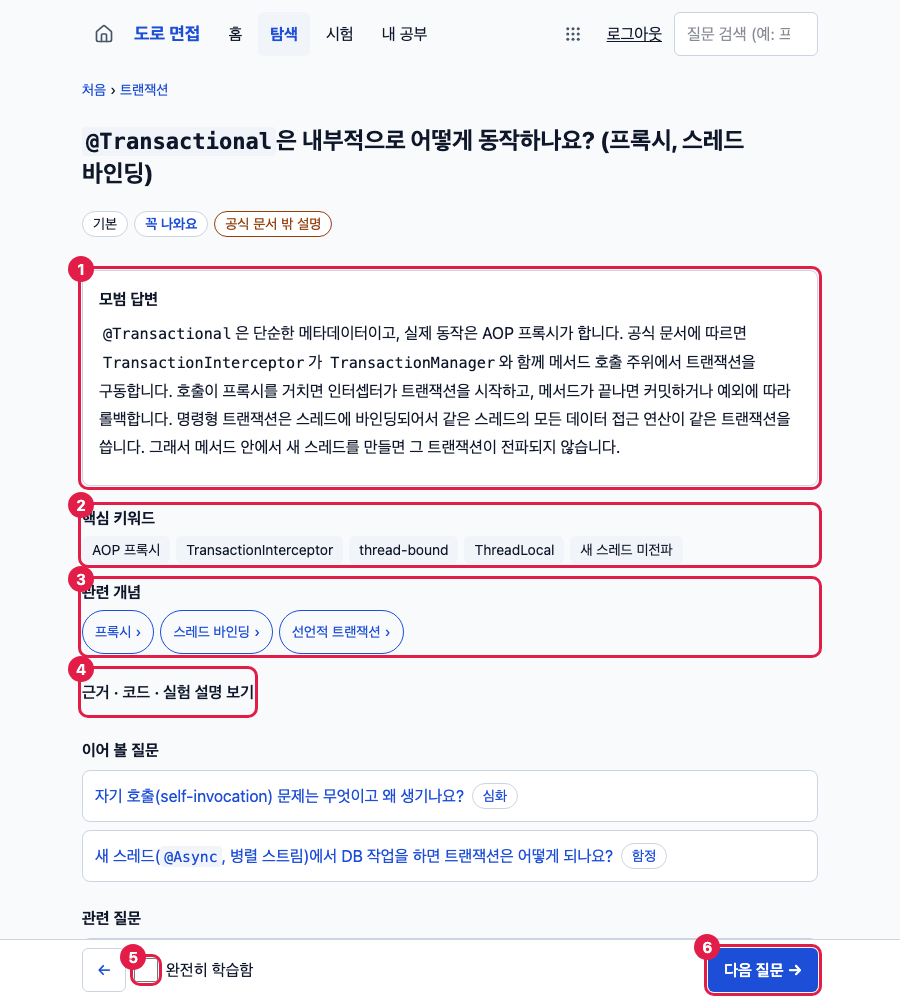

1. **모범 답변**: 말로 하면 30~60초 분량으로 쓴 답변입니다. 소리 내어 읽어 보세요.
2. **핵심 키워드**: 답변에 꼭 들어가야 하는 말입니다. 답하면서 빠뜨리지 않았는지 점검합니다.
3. **관련 개념**: 누르면 그 개념의 다른 질문 목록으로 갑니다.
4. **근거 · 코드 · 실험 설명 보기**: 눌러서 펼치면 근거와 코드가 나옵니다. 출처는 `(공식 문서)`, `(보충)`, `(실험 확인)`으로 구분해 표시합니다. 아래에는 먼저 볼 질문, 이어 볼 질문, 관련 질문이 이어집니다.
5. **완전히 학습함**: 체크하면 진도에 반영되고 시험에 나올 후보가 됩니다.
6. **다음 질문 →**: 주제 안의 다음 질문으로 갑니다(← 로 이전 질문).

## 5. 노트 남기기

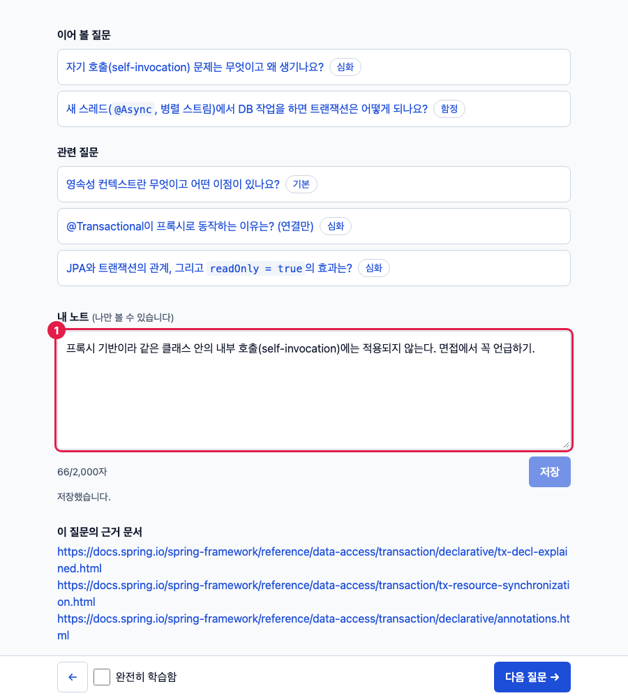

1. 질문 화면 맨 아래의 **내 노트**에 적고 **저장**을 누릅니다. 나만 볼 수 있고 2,000자까지 쓸 수 있습니다. 아래에는 그 질문의 근거 문서 링크가 있습니다.

## 6. 시험 시작하기

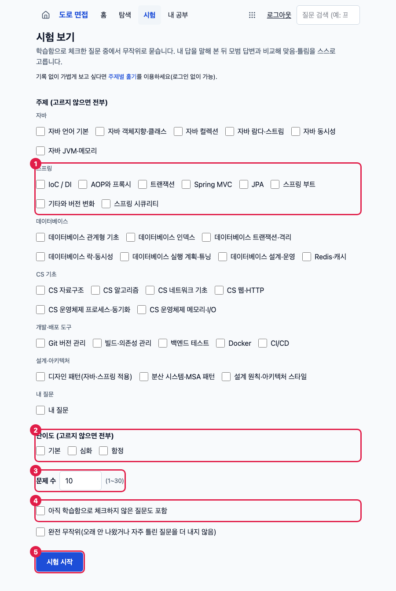

**시험**에서 범위를 고르고 시작합니다. 시험은 **학습함으로 체크한 질문** 중에서 나옵니다.

1. **주제**: 고르지 않으면 전부입니다. 카테고리별로 원하는 주제만 고릅니다. 직접 만든 질문은 맨 아래 "내 질문"에서 고릅니다.
2. **난이도**: 기본 · 심화 · 함정. 고르지 않으면 전부입니다.
3. **문제 수**: 1~30.
4. **아직 학습함으로 체크하지 않은 질문도 포함**: 체크하지 않은 질문도 섞어서 냅니다.
5. **시험 시작**.

그 아래의 **완전 무작위** 옵션을 켜면 "오래 안 나왔거나 자주 틀린 질문을 더 내는" 가중치를 쓰지 않습니다. 기본은 가중 랜덤입니다.

## 7. 답을 적어 보기

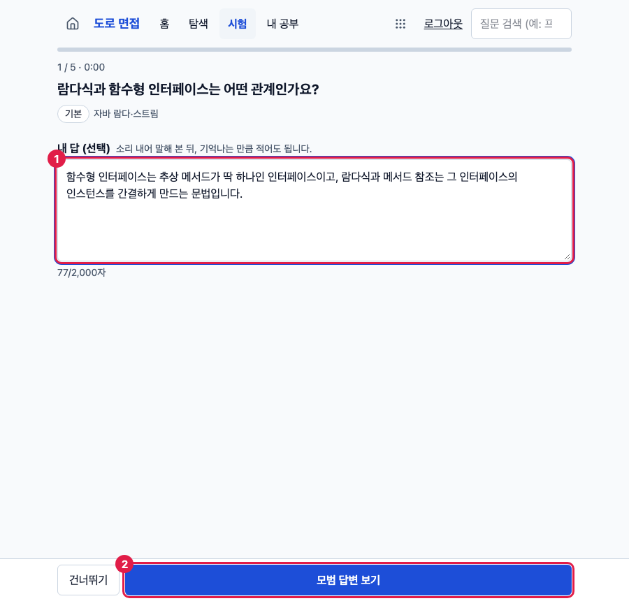

1. **내 답**: 소리 내어 말해 본 뒤 기억나는 만큼 적습니다. 비워 두고 넘어가도 됩니다.
2. **모범 답변 보기**: 눌러서 비교합니다. 모르겠다면 **건너뛰기**를 누릅니다.

문제 순서는 시작할 때 한 번에 정해지므로, 새로고침하거나 다시 들어와도 이어서 풀 수 있습니다.

## 8. 비교하고 채점하기

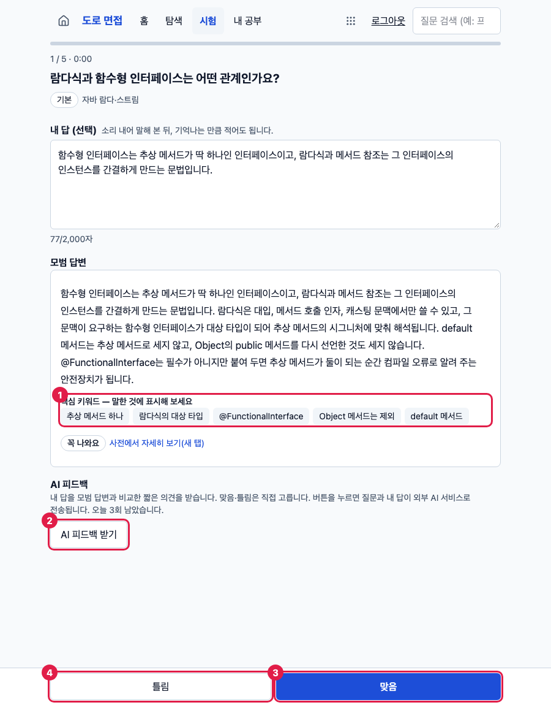

1. **핵심 키워드**: 내가 말한 것에 해당하는지 떠올려 봅니다.
2. **AI 피드백 받기**(선택, 서버에서 켜 둔 경우): 내 답과 모범 답변을 비교한 짧은 의견을 받습니다. 누르면 질문과 내 답이 외부 AI 서비스로 전송된다는 안내가 있고, 내 답이 비어 있으면 받을 수 없습니다.
3. **맞음 / 4. 틀림**: 채점은 직접 합니다. AI 피드백이 있어도 점수는 매기지 않습니다.

## 9. 결과 보기

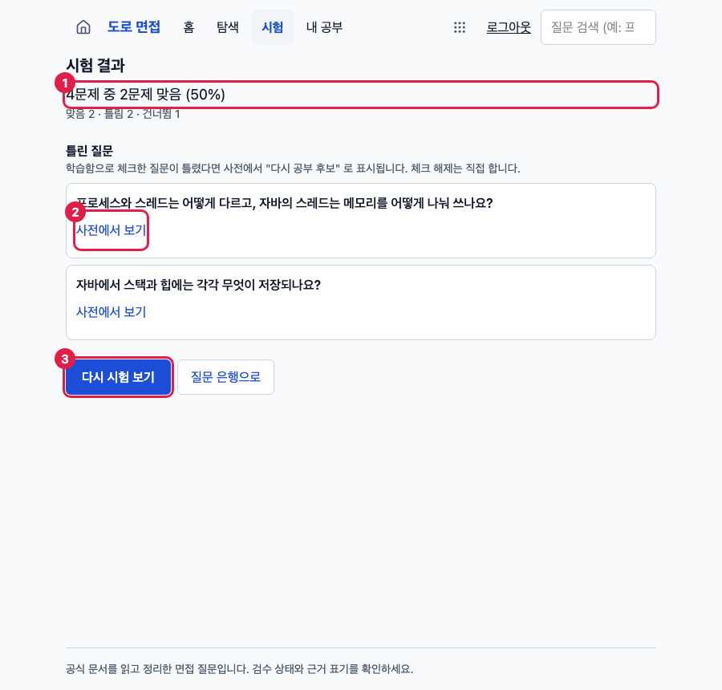

1. **점수**: 채점한 문제 중 맞은 비율과 맞음·틀림·건너뜀 개수.
2. **틀린 질문**: **사전에서 보기**로 해당 질문을 다시 읽습니다.
3. **다시 시험 보기** 또는 **질문 은행으로**. 학습함으로 체크한 질문이 틀렸다면 "다시 공부 후보"로 올라갑니다.

## 10. 다시 공부 후보 고르기

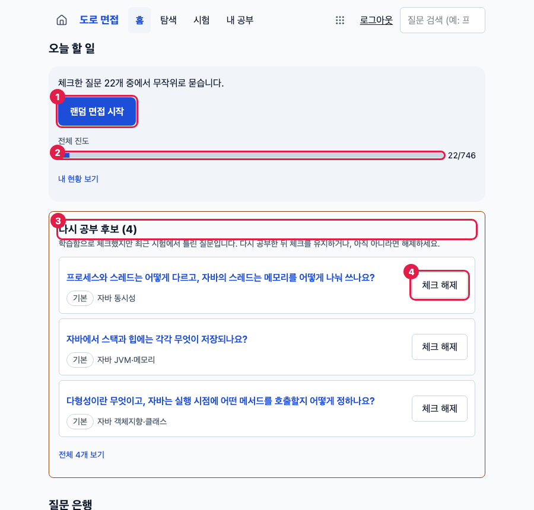

로그인하면 홈의 **오늘 할 일**에서 모든 것이 이어집니다.

1. **랜덤 면접 시작**: 체크한 질문 중에서 바로 시험을 시작합니다.
2. **전체 진도**: 체크한 질문 수 / 전체 질문 수.
3. **다시 공부 후보**: 학습함으로 체크했지만 최근 시험에서 틀린 질문입니다. 제목을 눌러 다시 읽습니다.
4. **체크 해제**: 아직 아니라고 판단하면 학습함 체크를 풉니다. 다시 공부해서 체크를 유지하면 그대로 둡니다. 체크 해제는 자동으로 되지 않고 직접 합니다.

## 11. 내 현황

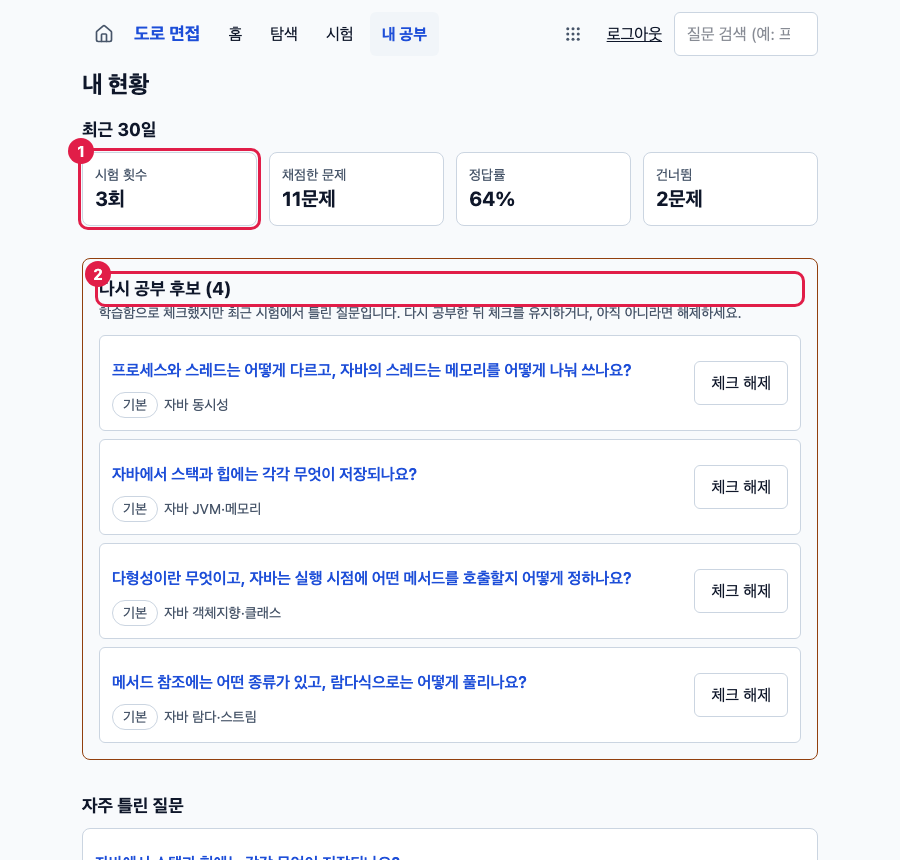

**내 공부 → 내 현황**(또는 홈의 "내 현황 보기")에서 확인합니다.

1. **최근 30일**: 시험 횟수, 채점한 문제 수, 정답률, 건너뜀.
2. **다시 공부 후보**와 그 아래 **자주 틀린 질문** 목록.

## 12. 내 공부

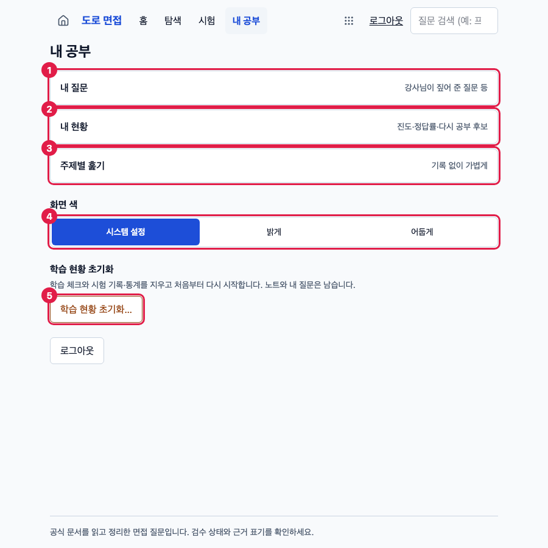

1. **내 질문**: 직접 만든 질문을 모아 봅니다([14번](#14-내-질문-추가하기)).
2. **내 현황**: [11번](#11-내-현황).
3. **주제별 훑기**: [16번](#16-주제별-훑기).
4. **화면 색**: 시스템 설정 · 밝게 · 어둡게. 이 브라우저에 저장됩니다.
5. **학습 현황 초기화**: 처음부터 다시 시작할 때 씁니다([13번](#13-학습-현황-초기화)).

## 13. 학습 현황 초기화

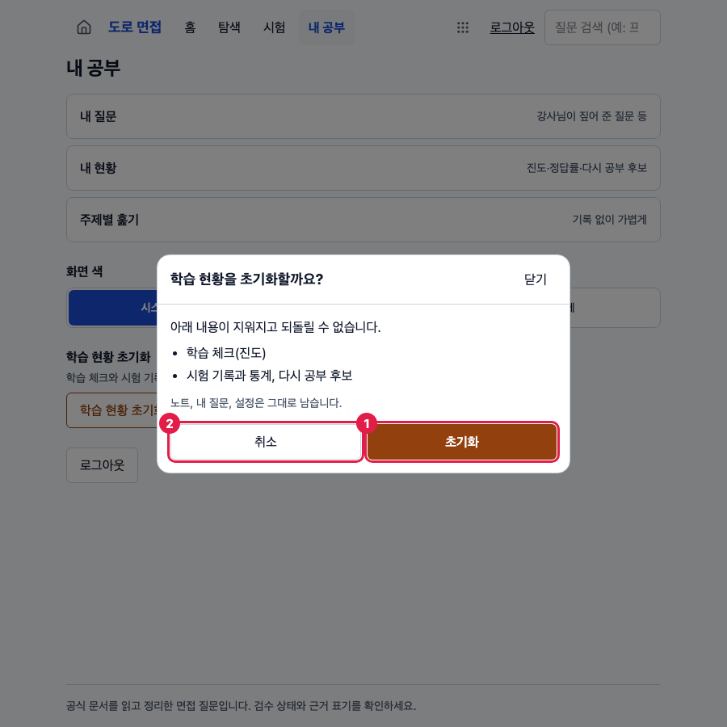

**학습 현황 초기화…** 를 누르면 확인창이 뜹니다. 아무것도 지워지지 않았으니 안심하고 읽어 보세요.

1. **초기화**: 학습 체크(진도)와 시험 기록·통계·다시 공부 후보가 지워지고 **되돌릴 수 없습니다**.
2. **취소**: 닫기만 하고 그대로 둡니다.

**노트, 내 질문, 설정은 남습니다.**

## 14. 내 질문 추가하기

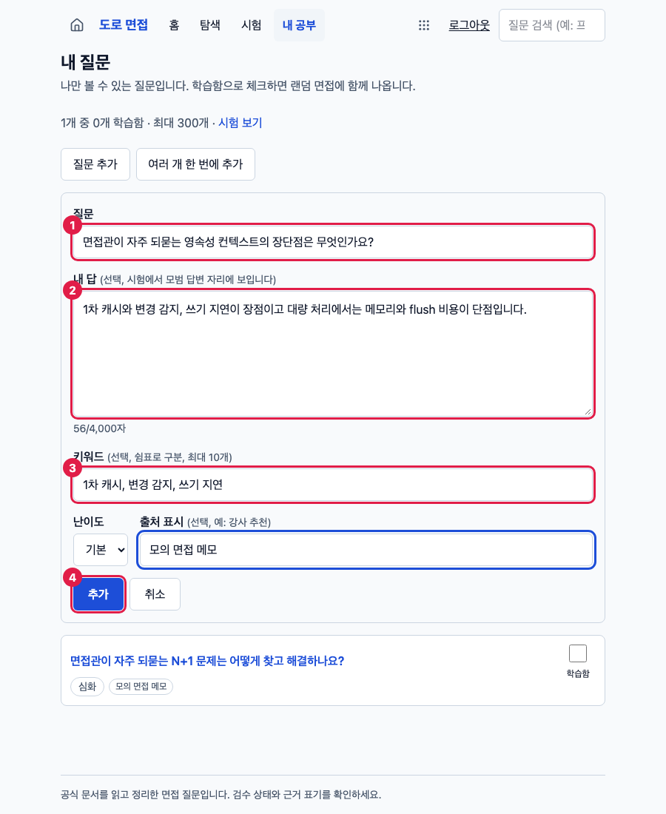

강사님이 짚어 준 질문이나 모의 면접에서 나온 질문을 직접 넣어 두면 시험에 함께 나옵니다. **내 공부 → 내 질문 → 질문 추가**.

1. **질문**: 필수입니다.
2. **내 답**(선택): 시험에서 모범 답변 자리에 보입니다.
3. **키워드**(선택): 쉼표로 구분하고 최대 10개입니다.
4. **추가**. 난이도와 출처 표시(예: 강사 추천)도 고를 수 있습니다.

질문이 여러 개라면 **여러 개 한 번에 추가**에 한 줄에 하나씩 붙여 넣습니다(답은 나중에 각 질문에서 적습니다). 목록에서 **학습함**으로 체크하면 시험에 나오고, 시험 시작 화면에서는 "내 질문"만 골라서 볼 수도 있습니다.

## 15. 검색

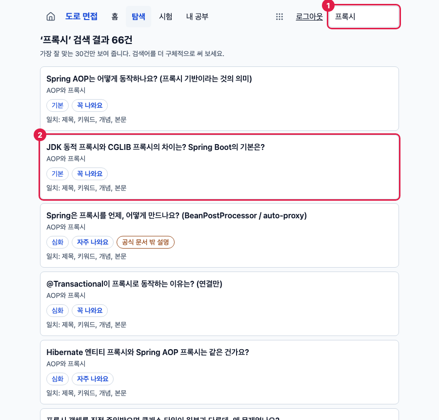

1. 헤더의 검색창에 단어를 적고 Enter를 누릅니다(폰에서는 돋보기 아이콘).
2. 결과마다 **일치한 곳**(제목, 키워드, 개념, 본문)이 표시되고, 가장 잘 맞는 30건을 보여 줍니다. 결과가 많으면 검색어를 더 구체적으로 써 보세요.

## 16. 주제별 훑기

로그인 없이 쓸 수 있고 **어떤 기록도 남기지 않습니다**. 질문 제목만 보고 아는 것을 떠올리는 가벼운 복습입니다.

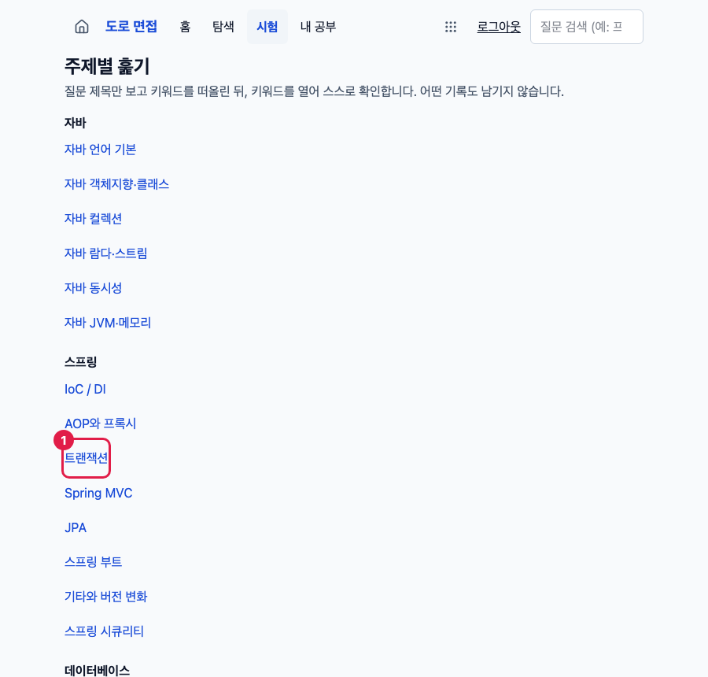

1. 훑을 **주제**를 고릅니다.

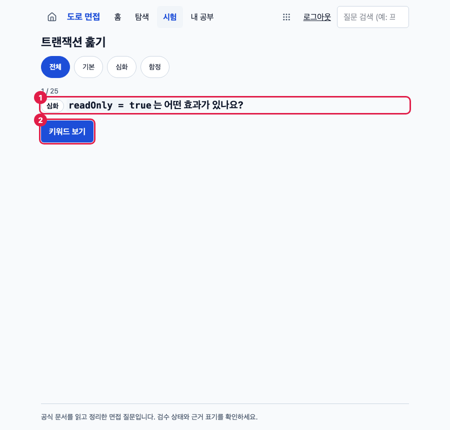

1. 질문 **제목**만 보고 아는 키워드를 먼저 떠올립니다.
2. **키워드 보기**를 눌러 확인합니다.

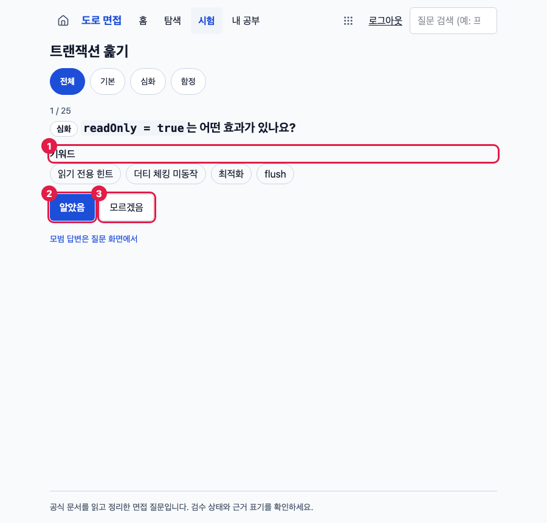

1. **키워드**를 보고 내가 떠올린 것과 맞춰 봅니다.
2. **알았음** / 3. **모르겠음**을 고릅니다. 끝나면 "N문제 중 M문제는 알았고…" 요약과 함께 모르겠음으로 표시한 질문을 모아서 보여 줍니다. 모범 답변은 질문 화면에서 봅니다.

## 17. 폰에서 쓰기

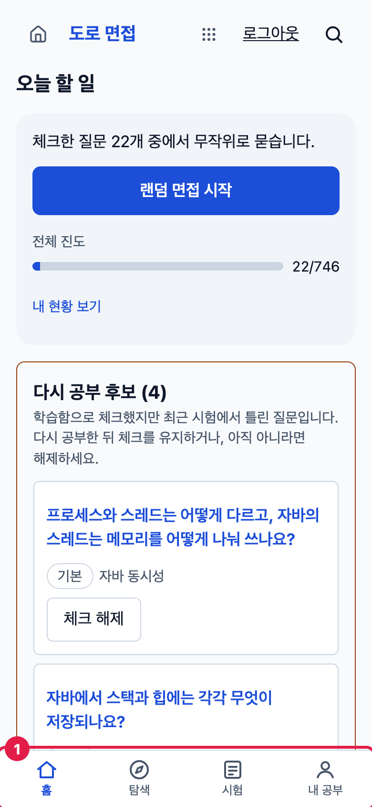

1. **아래 탭 바**: 홈 · 탐색 · 시험 · 내 공부를 엄지로 오갑니다. 검색은 헤더의 돋보기입니다.

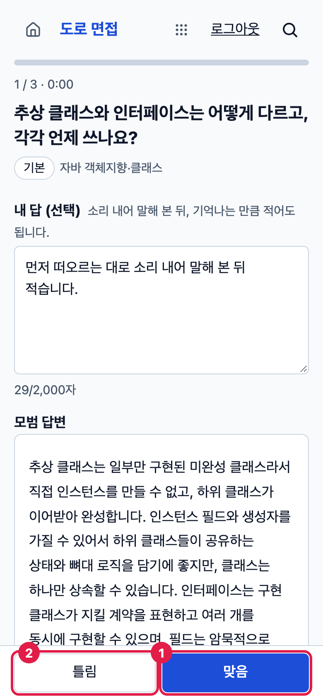

1. **맞음 / 2. 틀림**: 시험 중에는 탭 바 자리에 채점 버튼이 고정됩니다. 그래서 길게 스크롤한 뒤에도 바로 채점할 수 있습니다.

**홈 화면에 설치(PWA)**: 폰 브라우저의 공유/메뉴에서 "홈 화면에 추가"를 고르면 앱처럼 열립니다. 어두운 화면이 좋다면 [내 공부](#12-내-공부)에서 화면 색을 바꾸세요.

## 자주 묻는 것

- **시험에 문제가 안 나와요**: 시험은 학습함으로 체크한 질문에서 나옵니다. 체크가 없다면 시작 화면에서 "아직 학습함으로 체크하지 않은 질문도 포함"을 켜세요.
- **체크를 잘못 했어요**: 주제 화면이나 질문 화면의 체크박스를 다시 눌러 풉니다.
- **기록을 모두 지우고 싶어요**: [13번](#13-학습-현황-초기화).
- **같은 질문이 계속 나와요**: 틀린 질문과 오래 안 나온 질문이 더 잘 나오도록 만든 기본 동작입니다. "완전 무작위"를 켜면 달라집니다.
